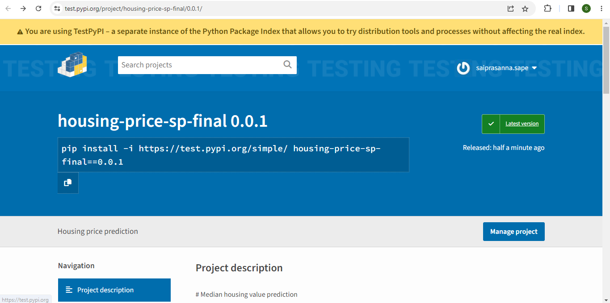

# mle-training
# Median housing value prediction

The housing data can be downloaded from https://raw.githubusercontent.com/ageron/handson-ml/master/. The script has codes to download the data. We have modelled the median house value on given housing data.

The following techniques have been used:

 - Linear regression
 - Decision Tree
 - Random Forest

## Steps performed
 - We prepare and clean the data. We check and impute for missing values.
 - Features are generated and the variables are checked for correlation.
 - Multiple sampling techinuqies are evaluated. The data set is split into train and test.
 - All the above said modelling techniques are tried and evaluated. The final metric used to evaluate is mean squared error.

## Uploading the distributive archives
   1.Extract the zip file
   2.python3 -m pip install --upgrade twine
   3.python3 -m twine upload --repository testpypi dist/*
   4.

## Installing newly uploaded package
  1.Open the ubuntu command prompt
  2.Use this "conda env create -f env.yml" to create an environment with necessary libraries
  3.python3 -m pip install --index-url https://test.pypi.org/simple/ --no-deps housing_price_sp_final

## Test Scripts
  1.python3 tests/functional_tests/test_ingest_data.py
  2.python3 tests/unit_tests/test_train.py
  3.python3 tests/unit_tests/test_score.py

